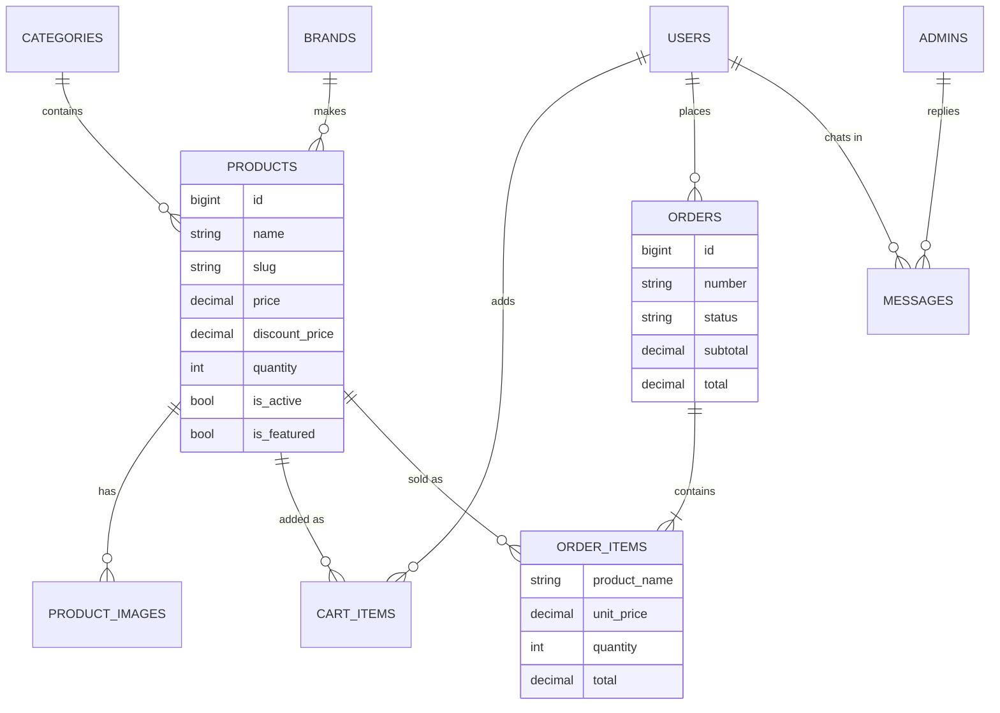

# DashStore

A full-featured e-commerce store built with **Laravel 12**: a customer-facing storefront and an admin dashboard for managing the catalog, orders and customers.

> 🚧 **Status:** under active development. See the [roadmap](#roadmap) below.


---

## Features

Target scope of the project. Progress is tracked in the [roadmap](#roadmap).

**Storefront (customers)**
- Browse products by category and brand, with search and filters
- Product pages with image gallery, discounts and stock status
- Shopping cart and checkout
- Order history and order tracking
- Support chat with the store

**Admin dashboard**
- Separate admin authentication (dedicated guard)
- Manage categories, brands and products (with multiple images)
- Order management with an enforced status workflow
- Sales statistics and recent activity
- Reply to customer messages

## Tech stack

| Layer      | Technology                                  |
|------------|---------------------------------------------|
| Backend    | PHP 8.2+, Laravel 12, Eloquent ORM          |
| Frontend   | Blade, Bootstrap, SB Admin 2, Vite          |
| Database   | MySQL (SQLite for tests)                    |
| Auth       | Laravel session guards (`web` + `admin`), Sanctum |
| Testing    | PHPUnit 11                                  |

## Database design



A few design decisions worth noting:

- **Order items snapshot the product** (name and unit price at purchase time), so editing or deleting a product never changes past orders.
- **Order status is a PHP enum** (`App\Enums\OrderStatus`) with explicit allowed transitions, for example a shipped order can't be cancelled.
- **Real foreign keys** with deliberate delete rules: you can't delete a category that still has products, and deleting a brand just un-links its products.
- **Slugs** are generated automatically and used in URLs.

## Getting started

### Requirements

- PHP 8.2+ and Composer
- Node.js 18+ and npm
- MySQL 8 (or MariaDB)

### Installation

```bash
git clone https://github.com/abodmasoud/DashStore.git
cd DashStore

composer install
npm install

cp .env.example .env
php artisan key:generate
```

Create a database named `dashstore` and update the `DB_*` values in `.env`. Then:

```bash
php artisan migrate --seed
npm run dev
php artisan serve
```

### Demo accounts

| Role     | Email                     | Password   |
|----------|---------------------------|------------|
| Admin    | `admin@dashstore.test`    | `password` |
| Customer | `customer@dashstore.test` | `password` |

- Store: http://localhost:8000 (log in at `/login`)
- Admin dashboard: http://localhost:8000/admin (log in at `/admin/login`)

The seeder also creates 5 categories, 6 brands, 60 products (some discounted, some out of stock) and sample orders.

### Running tests

```bash
php artisan test
```

Tests run against an in-memory SQLite database, so they don't need MySQL.

## Roadmap

- [x] **Foundation:** Laravel 12 upgrade, database redesign, factories, seeders, tests
- [x] **Authentication:** customer login and registration, separate admin login, rate limiting
- [ ] **Admin catalog:** CRUD for categories, brands and products with image uploads
- [ ] **Storefront:** home page, product listing and filters, product page, cart, checkout
- [ ] **Orders and dashboard:** order management, status workflow, sales statistics
- [ ] **Polish:** screenshots, CI with GitHub Actions, live demo

## License

Released under the [MIT License](LICENSE).

---

Built by [Abdulrahman Masoud](https://github.com/abodmasoud).
